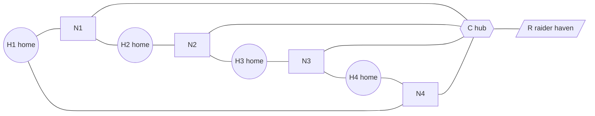

# 10 — Universe structure

Status: **Agreed (round 4).** Built on D-020, D-021, D-022 and D-038, and on RK-08 and RK-11 from doc 04. Q35–Q40 were decided as D-041 to D-046. Still working proposals: naming (§9), the data model sketch (§10) and the ops-area radius (§8). Labels: *Agreed* means a decision ID is given, *Derived* means it follows from agreed decisions, and *Proposed* means it needs the owner's approval.

## 1. Scope

This document defines:

- the hierarchy of the Universe and its scale;
- how systems are connected and how long travel takes;
- what a site and a holding are;
- what "controlling a system" means;
- how a season's galaxy is generated, and where commanders start;
- the coordinate frames and units.

Other documents own the rest: the resource chain (14), ships, combat and claiming in detail (15), sensors and fog of war (16), the system and sector views (17), and the simulation clock and persistence (11).

## 2. Hierarchy

| Level | Role | Status |
|---|---|---|
| **Universe** | The one persistent instance: accounts, season history, blueprints (D-035). It outlives seasons. | Agreed (D-021) |
| **Season galaxy** | A newly generated galaxy at the start of each season, from a recorded seed. | Agreed (D-044) |
| **Sector** | A cluster of 12–16 systems; a natural neighbourhood of 6–8 commanders. | Agreed (D-022, D-043) |
| **System** | A star, orbits, 5–9 sites and 2–4 gates. The unit of system control (§6). | Agreed (D-022) |
| **Site / holding** | A fixed location in a system. A site owned by a commander is a **holding**. | Agreed (D-022); details proposed |
| **Ops grid** | The tactical plane of a holding; one per holding. | Agreed (D-022) |
| *Arm, Orbit* | Flavour and positioning only. | Agreed (D-022) |

*Derived:* in the MVP the local server hosts its own Universe (D-026, D-029). "One Universe" (D-021) refers to the hosted game.

## 3. Scale targets

*Agreed (D-043).* The key ratio is about **15 sites per commander**: about 2 systems' worth. Early in the season there is plenty of room to expand. By late season roughly half the sites are claimed, so expansion turns into conflict.

| | MVP stage 1 (D-038) | MVP stage 2 | Full Universe (D-021) |
|---|---|---|---|
| Commanders | 4 (1 human, 3 AI) | Up to 10 | Up to 100 |
| Active sectors | 1 | 2 | ~14 |
| Reserved frontier sectors (§7) | 0 | 0 | 2 |
| Systems (claimable) | 9 | ~20 | ~240 |
| Sites | ~60 | ~140 | ~1,700 |
| NPC raider havens | 1 | 2 | ~1 per sector |

*Derived (sizing check):* ~240 systems and ~1,700 sites, plus fleets, stays on the order of 10⁴ simulated entities. That is consistent with one authoritative process (P-04) on `hecs` (D-030).

## 4. Topology

### 4.1 Systems

- A system has a star, flavour orbits (D-022), **5–9 sites**, and **2–4 gates** at its edge. A hub system may have up to 5 gates. *(Agreed, D-043.)*
- Kinds of system *(Agreed, D-043)*:
  - **Home:** 7 sites, one of them holding a commander's mother station at season start.
  - **Standard:** 5–7 sites.
  - **Hub:** 8–9 sites with richer deposits, the contested centre of a sector.
  - **Raider haven:** NPC raiders operate from here. Not claimable in the MVP, and not counted for control. It has no sites or deposits and one gate, to the hub (D-099).
- In-system trips between any two points take **at most 15 min** at cruise speed. The 50 km minimum site spacing sets the floor (D-099). The phase-1 relief fleet's ETA of 04:00 from gate K-OST to KR-114 fits this. Ship speeds are set in doc 15. *(Agreed, D-043.)*

### 4.2 Lanes

| Lane | Connects | Travel | Interception |
|---|---|---|---|
| **In-system lane** | Gates and sites inside one system | Spatial: ships move in the system frame | Yes: blockades and convoy raids happen here (the phase-1 "ORE CONVOY · lane unsafe") |
| **Jump lane** | Gate to gate, between systems in one sector | Timed transit, **40–70 min** depending on the lane | **No.** Transit cannot be interrupted (D-042). Fleets leave from one gate and arrive at the other. |
| **Trunk lane** | Border systems of neighbouring sectors | Timed transit, **90–150 min** | No (D-042) |

*Agreed (D-042):* jump transit cannot be interrupted. All interception happens inside systems, mostly at gate approaches. This keeps the simulation spatial only inside systems: a fleet in transit is just a timer. It also makes gates the natural chokepoints. Their weakness, arrival into a waiting enemy fleet ("gate camping"), is a combat question for doc 15.

### 4.3 Generator invariants

*Agreed (D-043).* The galaxy generator must guarantee all of these, and a test checks every generated galaxy against them:

1. The whole galaxy is connected. Each sector's internal graph contains at least one cycle. **No lane is a bridge, except lanes to raider havens**, so there is always more than one route of attack (D-099).
2. Sector diameter is **at most 4 jumps**.
3. **The worst-case trip between any two sites in a sector takes at most 6 h** for the slowest *commander* warship, the WARDEN (RK-08, half of the 12 h notice). Nominal check: 4 × 70 min plus 5 in-system legs of about 10 min ≈ 5.5 h. Once ship speeds exist, the check also includes the 5 s gate spool-up and the tactical-speed legs inside ops areas (D-099).
4. Home systems are at least 2 jumps apart.
5. Each home neighbourhood (all systems within 2 jumps) has a total deposit value within ±10% of every other home's. Precisely, the richest neighbourhood is at most the poorest + 10% (D-099).
6. Dead ends make up at most 10% of systems, not counting raider havens.
7. Each sector borders 2–4 others through trunk lanes. This applies only to galaxies with at least 3 sectors (D-099).

### 4.4 MVP stage 1 sector

*Agreed (D-043).* Four home systems on a ring, four standard systems between them, and a hub in the centre with a raider haven attached. Controllable systems: 9. The longest route between homes is 4 jumps (H1 → N1 → C → N2 → H3).



Sites: 4 homes × 7, plus 4 standard × 6, plus a hub with 8, gives 60 sites, which is 15 per commander. The hub has 5 gates. Raiders reach the whole sector through the hub, which gives every commander a reason to care about it.

### 4.5 Full galaxy

*Agreed (D-043).* About 14 active sectors, laid out along flavour arms (D-022), plus 2 reserved frontier sectors (§7). Crossing the galaxy takes on the order of a day of travel. Play is therefore regional: relief within a sector is always possible inside the notice period, while help from across the galaxy is not.

## 5. Sites and holdings

- **Site attributes** *(Proposed)*:
  - its position (orbit and angle, which give the system-frame position);
  - its **deposits**, the resource fields such as the phase-1 asteroid field AST-1; types and richness are defined in doc 14;
  - its **build area**, the extent of the ops grid available for modules.
- **Holding:** a site with a completed **core module** owned by a commander. The mother station's site is that commander's first holding. *(Agreed, D-041; the core-module rule comes from RK-09.)*
- **Claiming** *(Proposed; cost and timing in doc 15)*: a commander deploys a core module on a free site. Until the core is complete, the site is an *outpost* and follows the peripheral rules (doc 12 §3). Once it is complete, the site becomes a holding with a minimal dome.
- **Ownership is public; contents are not** *(Agreed, D-044; detailed in doc 16)*. Everyone can see who owns which holding: the system-control bar and the season leaderboard need this. Modules, fleets and stockpiles are visible only through sensors (D-039).
- **Resources:** whether stockpiles are global per commander or local per holding, which would require convoys, is decided in doc 14. This topology supports both.

## 6. System control

*Agreed (D-041).*

| State | Condition |
|---|---|
| **Controlled by X** | X owns a **strict majority** of the system's sites as holdings: at least ⌊n/2⌋+1, so 4 of 7. |
| **Contested** | Nobody has a majority, and at least two commanders own holdings there. |
| **Open** | Nobody has a majority, and at most one commander owns holdings there. |

This matches the phase-1 system panel: in Kestrel-7, "YOU 3 · HSTL 2 · FREE 2" with no majority is **CONTESTED**.

- **What counts:** holdings with a completed core, including a mother-station holding. Outposts do not count; otherwise control would be cheap to fake.
- **What control gives during the season:** sensor coverage of the whole system, meaning all gates and in-system lanes are visible to the controller (ties to D-039). This makes control matter before the season ends. Any economic bonuses are for doc 14 to decide.
- **Season result (D-020):** an early win requires 60% of claimable systems, rounded up (6 of 9 in MVP stage 1). Otherwise the commander with the most controlled systems at season end wins. Tie-breaks, in order: holdings owned, total deposit value held, then whoever reached the final count first.
- **Alliances (D-040):** whether alliance members' holdings are pooled for control is decided together with the alliance design. The MVP counts per commander.

## 7. Season start and late joiners

**Season start** *(Agreed, D-044)*:

- Each season generates a **new galaxy from a recorded seed**, so the map is fresh and no one has a memorised advantage.
- The topology (systems, gates, lanes, site positions and deposit classes) is **fully charted** from the start; there is no exploration in the MVP.
- Ownership is public. Everything else is subject to fog of war (D-039).
- Every commander starts at season start with a mother station in their own home system. Saved blueprints (D-035) make the initial build quick.

**Late joiners (RK-11)** *(Agreed, D-045)*:

- The generator creates frontier sectors sized for 15% of the commander cap. They stay dormant, with their trunk gates closed, until the first late joiner arrives.
- A late joiner starts in a frontier home system with 7 days of protection: their holdings cannot enter Reinforced. The protection ends early if they take any offensive action.
- They receive a start grant scaled to how much of the season has passed (the same idea as the comeback grant, D-034).
- No joins in the last 14 days of a season.

## 8. Coordinate frames and units

| Frame | Units and axes | Use |
|---|---|---|
| **Galaxy** | Abstract 2D layout units | Drawing the galaxy and sector maps only. Travel times are properties of lanes, not distances. |
| **System** | km in documents and UI, stored in metres in the simulation (doc 11 §5, D-099); 2D, origin at the star, +y = system north | Sites, gates, in-system movement, combat |
| **Grid** (holding) | Voxels; `x`, `y` horizontal, `z` up; origin at the core (phase 1) | Modules, rendering, local effects |

- **1 voxel ≈ 35 m.** *Derived* from the phase-1 fixture: HSTL-C1 is reported at 3.1 km and sits 88.9 voxels from the dome centre. The shield dome's radius of 36 voxels is therefore about 1.26 km.
- **Movement and combat are 2D in the system frame.** *Derived* from the single ship plane (D-003). Height exists only for presentation: the ship plane at z = 16 and the structure elevation tiers. This is a major simplification for the simulation and the AI.
- **Ops area:** the region around a site where the tactical ops-grid view applies. Radius 20 km, ≈ 570 voxels (agreed, D-103). Sites sit at least 50 km apart, so ops areas never overlap. The phase-1 camera clamp of ±200 voxels (7 km) fits well inside. The baseline holding sensor range is 40 km (the phase-1 minimap "PULSE · 40 KM"), detailed in doc 16.
- **Grid north equals system north.** Grid north is azimuth 225° in grid xy: screen-up in view 0, consistent with the north-up minimap drawn in the view-0 projection.
- **Phase-1 finding (resolved, D-046):**
  - The four pylons sit at azimuths 225° (N), 315° (E), 45° (S) and 135° (W) around the dome centre. These are exactly the **boundaries** of the shield sectors in phase-1 doc 01 §6 (N 225–315° and so on), not their centres.
  - *Agreed:* each arc is centred on its pylon: N 180–270°, E 270–360°, S 0–90°, W 90–180°. The siege scenario still holds: the hostile cruiser at 335° remains in the weakened E sector.
  - Phase-1 doc 02's camera clamp, formerly "sector bounds", is renamed "ops-area bounds". Both changes are applied to the phase-1 package.

## 9. Naming

*Proposed:* sectors take names from a word list (Veil Sector). A system is a name plus a number (Kestrel-7). A site ID is a two-letter system code plus a number (KR-114). A holding keeps its site ID when captured. Arms are flavour names (Orion Arm).

## 10. Data model sketch

*Proposed. This is input for docs 11 and 20; names are indicative.*

```text
Universe   { id, season, seed, sectors[], frontier_sectors[] }
Sector     { id, name, systems[], trunk_links[] }
System     { id, name, sector, kind: Home|Standard|Hub|Haven, sites[], gates[] }
Gate       { id, system, position_km, jump_lanes[] }
JumpLane   { gate_a, gate_b, transit_s, kind: Jump|Trunk }
Site       { id, system, position_km, deposits[], build_area, holding: Option<HoldingId> }
Holding    { id, site, owner: CommanderId, core: ModuleId, ... }   // detail in doc 15
ControlState = Controlled(CommanderId) | Contested | Open           // derived each tick from holdings
```

## 11. Stress test

1. **Land grab decides too much.** System control by majority, combined with free sites, rewards fast early claiming. Commanders will probably control their home system within the first days, so the season is fought over standard and hub systems. That is intended, but the AI and the claim costs (doc 15) must make expansion a trade-off, not a race.
2. **The 60% early win is mostly theoretical in a 100-commander free-for-all.** It matters in the MVP and with alliances. Without alliances, "most systems at season end" decides, and late-season sieges get compressed into the final days. *Watch in pacing simulations (D-037):* if this happens, an option is to count average control over the last 2 weeks instead.
3. **Gates as chokepoints.** Uninterruptible transit (D-042) makes gate approaches decisive. A system with 2 gates can be sealed by 2 blockades. Mitigations are 2–4 gates per system (invariant 6 limits dead ends) and doc 15's arrival rules.
4. **The 6 h trip invariant strengthens defenders,** because relief can always arrive inside the notice period. This is deliberate (RK-08), but it adds to the risk of stagnation (RK-02). The pacing simulation measures it.
5. **Frontier sectors as safe havens.** Late joiners' protection ends on their first offensive action, and frontier sectors connect to the galaxy through ordinary trunk lanes, so they are not sealed off.
6. **A fully charted map removes exploration** as a source of play. That is acceptable for the MVP; exploration can be added later without changing the model.

## 12. Defaults (agreed as starting values, D-043)

| Parameter | Value |
|---|---|
| Sites per commander (galaxy-wide) | ~15 |
| Sites per system | 5–9 (home 7, standard 5–7, hub 8–9) |
| Gates per system | 2–4 (hub up to 5) |
| Systems per sector | 12–16 (MVP stage 1: 9 + 1 haven) |
| Commanders per sector at start | 6–8 (MVP stage 1: 4) |
| Jump lane transit | 40–70 min |
| Trunk lane transit | 90–150 min |
| In-system trips | 2–15 min |
| Sector diameter | ≤ 4 jumps |
| Worst-case trip within a sector | ≤ 6 h |
| Ops area radius / minimum site spacing | 20 km / 50 km |
| Voxel scale | ≈ 35 m |
| Frontier reserve | 15% of the commander cap |
| Late-joiner protection | 7 days |
| No joins in the final | 14 days |

## 13. Effect on other documents

- **Doc 14:** global or local stockpiles; deposit types and richness; economic effects of system control, if any.
- **Doc 15:** claim cost and time, outposts, gate arrival and blockades, ship speeds that fit §4.1 and invariant 3.
- **Doc 16:** public ownership, sensor coverage from control, baseline sensor ranges.
- **Doc 17:** galaxy, sector and system views drawn from the galaxy and system frames.
- **Phase 1:** D-046 applied (pylon arcs, "ops-area bounds").
- **Glossary:** site, outpost, hub, raider haven, frontier sector, jump lane, trunk lane, the control states, ops area.
