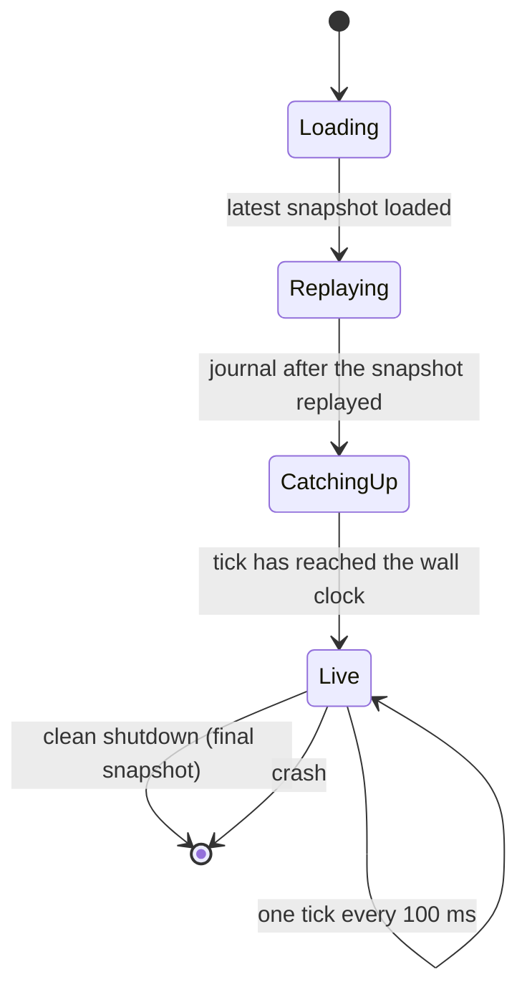

# 11 — Time and simulation

Status: **Agreed (round 5).** Q41–Q44 were decided as D-047 to D-050. Built on D-019, D-026, D-029, D-030, D-036, D-037 and P-04, on C-02, C-03, C-05 and C-06 from doc 01, and on `CODING_STANDARDS.md` §8. Labels: *Agreed* means a decision ID is given, *Derived* means it follows from agreed decisions, and *Proposed* means it needs the owner's approval.

## 1. Scope

This document defines:

- the simulation clock;
- how game time maps to real time;
- the timer layers;
- the order of work inside a tick;
- determinism;
- inputs and the command journal;
- persistence and recovery;
- what happens when the server is not running;
- the boundary between the simulation and everything around it.

Network replication and interest management belong to docs 16 and 20.

## 2. Clocks

| Clock | Definition | Status |
|---|---|---|
| **Tick** | A `u64` counter. One tick is **100 ms** (10 Hz). Tick 0 is the season start. The simulation knows no other time. | Agreed rate (D-019); counter proposed |
| **Universe time** | UTC, *computed* from the tick: `season_start_utc + tick × 100 ms`. Used for calendar rules: exposure windows, the 14-day activity history, season end, the late-join cutoff. | Proposed |
| **Wall clock** | Read **only by the server shell**, to pace ticks (§7). Never read inside the simulation. | Derived (`CODING_STANDARDS.md` §8) |

*Derived:* because Universe time is a pure function of the tick, calendar rules stay deterministic and replayable. Clients display Universe time in the player's local time zone. Exposure windows are UTC time-of-day ranges, so a player's local window moves when daylight saving time changes. The activity-derived window (D-032) absorbs that within days.

## 3. Timer layers

*Agreed in principle (D-019); assignments proposed.*

| Layer | Scale | Examples |
|---|---|---|
| **Tactical** | 100 ms – seconds | Movement, weapon cooldowns, projectiles, the Deputy's 300 ms reaction cap (3 ticks) |
| **Operational** | Minutes | Builds, in-system trips (2–15 min), the 60 min siege clock, the 10 min restore of disabled structures, the 120 s disconnect grace |
| **Strategic** | Hours | Jump transit (40–70 min), trunk lanes (90–150 min), the 12 h notice, 48 h immunity, 72 h post-jump protection |
| **Calendar** | Days to weeks | The daily exposure window, the 14-day activity history, a 14-day derelict threshold (outside the MVP), a 7-day late-join protection, seasons of 8–12 weeks |

**Representation** *(Proposed):*

- Every timer is stored as an absolute **deadline tick**, never as a countdown that is decremented each tick.
- Due timers fire from a min-heap ordered by `(deadline_tick, SimId)`.
- Calendar deadlines, such as "the start of the first window at least 12 h after the breach", are converted to a deadline tick when they are created, using the Universe-time mapping.
- Clients receive **deadlines, not countdowns**, and render countdowns locally. That keeps the HUD smooth without per-tick updates.

## 4. The tick

### 4.1 Phases and rate groups

*Proposed.* One `step` runs these phases in a fixed order. Systems that do not need 10 Hz run in **rate groups**. Their work is staggered across ticks by a stable hash of the entity or commander, so the load stays even.

| # | Phase | Rate | Notes |
|---|---|---|---|
| 1 | **Ingest inputs** | Every tick | Player commands, connect and disconnect events, operator commands (§6). Validated and ordered by `(commander, client_seq)`. |
| 2 | **Timers** | Every tick | Fire due deadlines: builds complete, Reinforced → Siege, protections end, transits arrive. |
| 3 | **AI commanders, strategic layer** | Every 10 s per commander, staggered | Expansion, offence, logistics (doc 13). |
| 4 | **Deputy, tactical layer** | 2 Hz per holding and fleet, staggered | Executes doctrine (doc 12, D-013, D-016). Its output is commands, which apply on the next tick. |
| 5 | **Movement and transit** | Every tick | 2D kinematics per star system (doc 10 §8); the jump-transit queue. |
| 6 | **Sensors and visibility** | 2 Hz | Per-commander visibility sets (doc 16, D-039). |
| 7 | **Combat** | Every tick | Targeting, fire, projectiles with swept hit tests, damage, shield sectors and their lifecycle (doc 15). |
| 8 | **Economy** | 1 Hz | Harvest, production, storage caps (doc 14, D-025). |
| 9 | **Derived state** | When it changes | System control (D-041), siege eligibility, activity sampling once per minute. |
| 10 | **Outputs** | Every tick | A change set for replication (doc 16), notifications, a state hash at a configurable interval. |

*Derived:* the Deputy and the AI commanders run **inside** the deterministic step. They are functions of the state and a seeded random-number generator, so they never have to be journaled. Replaying the journal reproduces their decisions.

### 4.2 Partitioning

*Proposed (P-04).* All spatial work runs per star system, in `SystemId` order. Star systems interact only through jump transit, which is handled as a separate, ordered merge step. That makes star systems natural units for parallel work later, for example with `rayon` across systems, without breaking determinism. The MVP runs on a single thread.

### 4.3 Budget

*Proposed targets*, to be measured in the pacing simulation (D-037):

- At full Universe scale: a mean tick of 30 ms or less and a 99th-percentile tick of 80 ms or less.
- Fast-forward speed of at least 50× real time at full scale, and at least 500× at MVP stage 1.

## 5. Determinism

*Agreed (D-049).* **Guarantee:** the same build, the same snapshot and the same journal produce bit-identical state. There is no guarantee across builds; the journal records the build ID, which is the git commit embedded at compile time.

| Rule | Why |
|---|---|
| Unit and movement numbers come from a **rules file** copied into the Universe at creation (D-104). | A season keeps its rules, and replay stays exact. |
| Every simulated object has a **`SimId(u64)`**, assigned in increasing order and never reused. The `hecs` `Entity` is only a storage handle. | `hecs` reuses entity IDs. `SimId` is the identity used in persistence, the protocol and ordering. |
| Where order affects the outcome, sort by `SimId`. Never depend on ECS or `HashMap` iteration order. | The order in which damage, captures and so on are applied must be stable. |
| Positions and headings are `f64`, in metres and radians, in the system frame. Transcendental functions (`sin`, `cos`, `atan2`, `sqrt`) come from the pure-Rust `libm` crate. No fast-math. | Basic IEEE operations are reproducible; platform maths libraries differ between Linux and Windows (D-029). |
| Resources are **integer milli-units**, and rates are integer milli-units per second with carried remainders. | Floating-point drift does not accumulate in the economy. |
| Random numbers come from per-purpose, per-system streams derived from `(season_seed, SystemId, purpose)` (ChaCha8 via `rand_chacha`). | Results do not depend on the order in which systems are processed. |
| No wall clock, I/O, threads or environment reads inside the simulation. | All non-determinism enters as journaled input. |

**CI check** *(Proposed):* a headless test runs N ticks twice from the same seed and compares state hashes. It is cheap enough for the Debug-only CI (D-010).

## 6. Inputs and the journal

*Agreed (D-048).* Anything that enters the simulation from outside is journaled with the tick it applies on:

- **Player commands.** A command received during tick *t* applies on tick *t + 1*, so command latency is at most 100 ms plus the network round trip.
- **Connect and disconnect events.** These are real inputs: they drive the 120 s grace period (doc 12 §5.3), the rule that a siege fails without an online attacker (doc 12 §4), and the activity-derived window (D-032).
- **Operator commands:** freeze, configuration changes, season start.

*Derived:* AI commanders' online and offline schedules (D-027) are generated from the seed. They are not journaled.

## 7. Running live, catching up, fast-forward

- **Live:**
  - The server shell paces one tick every 100 ms against a monotonic clock.
  - If a tick overruns, the following ticks run back-to-back until the simulation is level again.
  - Running behind for a sustained period raises an overload alarm.
- **Fast-forward:** the same loop without sleeping. It serves two purposes: the headless pacing runs (D-037), and catching up after the server was not running.
- **Catching up after downtime** *(Agreed, D-047)*:
  - When the server starts after an outage, it simulates the missed time at fast-forward speed until the tick reaches the wall clock again. The Universe ends up exactly where it would have been. Every timer scales equally, so this is not compression (D-036).
  - Nobody can connect during catch-up, so every commander is offline. The offline rules already cover that case. Sieges that fall due during the outage fail because no attacker is online, offensive orders have lapsed, and Deputies defend.
  - **NPC raiders do not start new raids during catch-up**, so an outage cannot hand them free targets.
  - For an exceptional, long outage on a hosted server, an operator may **freeze** the Universe instead. That shifts every deadline, protection and the season end by the length of the outage. It is an operator tool, not something that happens automatically.
- **MVP consequence (derived from D-026 and D-029):**
  - The MVP server runs on your PC, so the Universe only advances while that PC is on.
  - After the PC has been off, the server catches up when it starts. At the stage-1 target of 500× or more, a night off (8 h) takes about a minute and a week off about 20 minutes. The client shows the progress.
  - The local MVP server runs on Windows, next to the client. The hosted server targets Linux (D-029).

## 8. Persistence and recovery

*Agreed (D-048).* Snapshots plus a journal, stored in SQLite with write-ahead logging (D-030). The same model moves to PostgreSQL once the server is hosted.

| Item | Proposal |
|---|---|
| **Snapshot** | Full serialised Universe state, keyed by `SimId`, compressed with zstd. Written every **5 min** (3,000 ticks) and on clean shutdown, atomically. Estimated at a few MB at full scale. |
| **Journal** | Append-only inputs (§6) with tick and sequence number. **Flushed to disk at least once per second.** |
| **Worst-case loss on a crash** | At most about 1 s of player commands. Everything else is recomputed by replay. |
| **Recovery** | Load the latest snapshot, replay the journal entries after it, then catch up to the wall clock (§7). |
| **Retention** | The last 2 snapshots plus their journal; hourly snapshots for 48 h; daily snapshots for the rest of the season. Older journal entries are discarded. |
| **Upgrades** | The snapshot schema is versioned and migrated forward by newer builds. Until the first real Universe exists (milestone β), a format change may simply reject older snapshots (D-099). A journal is replayable only by the build that wrote it. A server upgrade therefore always goes clean shutdown → final snapshot → new build loads that snapshot. |
| **Read models** | Leaderboards, season history and account data are separate projections, not the authoritative state. |

*Why not a row per entity?* At 10 Hz with about 10⁴ entities, relational writes would dominate the tick budget. A deterministic simulation makes snapshots plus a journal both cheaper and more reliable.

## 9. Crate boundary

*Agreed (D-050); input for doc 20.*

| Crate | Owns | Must not |
|---|---|---|
| `nomad-sim` | `UniverseState`, `step(&mut state, &TickInputs) -> TickOutputs`, the Deputy and the AI (as modules or a sibling `nomad-ai` crate), snapshot (de)serialisation | Read the clock, do I/O, use threads or `tokio`, use the network |
| `nomad-server` (later) | Wall-clock pacing, the network (`quinn`), persistence (SQLite), the journal, catch-up, operator tools | Contain game rules |
| Headless harness | Fast-forward runs, pacing experiments (D-037), the determinism test | — |
| `nomad-client` | Rendering, input, interpolation between received ticks | Advance the simulation |

*Derived:* the same `nomad-sim` core runs in the server, the tests and the pacing tool. That is exactly why D-037 can be the seed of the server.

## 10. Stress test

1. **Determinism costs discipline:** `SimId`, sorted application, `libm`, integer resources. In return we get crash recovery by replay, reproducible pacing runs and bug reports that can be reproduced. If a determinism bug slips through, recovery still works from the latest snapshot, so we lose replay fidelity, not the Universe. The CI hash test catches regressions.
2. **A 10 Hz tick versus fast projectiles.** A bolt at about 800 m/s (phase-1 HUD: TTI 1.1 s at 0.9 km) covers 80 m, about 2.3 voxels, per tick. Hit tests must be swept (segment against shape), not point checks. That is a doc 15 rule.
3. **Catch-up turns downtime into offline time for everyone.** That is fair because everyone is affected equally, and the offline rules were designed for exactly this situation. Holding back NPC raids removes the one unfair element. Long hosted outages have the freeze tool.
4. **The MVP server stops when the PC is off.** Catch-up keeps the Universe consistent, but the AI commanders only "act overnight" in compressed form at the next start. Those decisions are identical to what live play would have produced, because the simulation is deterministic.
5. **Journal volume.** About 30 active players at RTS command rates produce millions of commands per day. Compaction after each snapshot keeps the journal to minutes.
6. **Server upgrades mid-season** depend on forward migration of snapshots. That is a real engineering cost. It applies only to the hosted server, and the clean-shutdown rule keeps it contained.
7. **The tick budget at full scale is unmeasured.** Partitioning by star system leaves parallelism available, and the pacing simulation measures the real cost before anything else is built on it.

## 11. Proposed defaults

| Parameter | Value |
|---|---|
| Tick | 100 ms (10 Hz) |
| Rate groups | 10 Hz (movement, combat), 2 Hz (sensors, Deputy), 1 Hz (economy), every 10 s (AI strategy), every 60 s (activity sampling) |
| Command latency | Applied on the next tick (≤ 100 ms plus network round trip) |
| Snapshot interval | 5 min, plus on clean shutdown |
| Journal flush | ≤ 1 s |
| Tick budget (full scale) | Mean ≤ 30 ms, p99 ≤ 80 ms |
| Fast-forward target | ≥ 50× full scale; ≥ 500× MVP stage 1 |
| Universe time | UTC, computed from the tick |
| Raids during catch-up | None started |

## 12. Effect on other documents

- **`CODING_STANDARDS.md` §8:** once this document is agreed, the determinism rules lose their "provisional" label and gain the `SimId`, `libm` and integer-resource rules.
- **Doc 12:** the connection rules depend on journaled connect and disconnect events. The 300 ms reaction cap is 3 ticks.
- **Docs 14 and 15:** integer resources, swept hit tests and deadline-based timers.
- **Doc 16:** change sets from phase 10; replicate deadlines, not countdowns.
- **Doc 20:** crate boundary (§9), persistence (§8) and the server lifecycle (§7).
